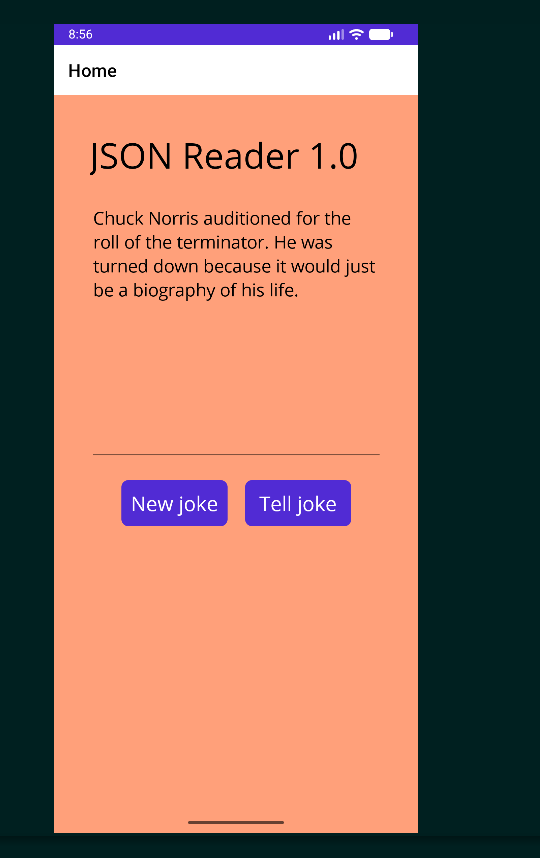

# JSON Reader 1.0

## Purpose and functionality

JSON Reader 1.0 is an Android app (C#, .NET 10, .NET MAUI) that downloads random Chuck Norris jokes in JSON format and displays them. It is a MAUI adaptation of the lecturer's Chapter 1 **"JSON Reader 1.0"** UWP exercise: pressing **New joke** fetches a joke from `https://api.chucknorris.io/jokes/random`, deserializes the JSON, strips any HTML markup, and shows the plain text; pressing **Tell joke** speaks the displayed text aloud via text-to-speech.

Beyond the original, it shows a loading indicator, disables the button during a request, and reports clear errors for network failures, timeouts, and malformed JSON, and it degrades gracefully if text-to-speech is unavailable.

## Technology stack

- C# on .NET 10 (`net10.0-android`)
- .NET MAUI (XAML)
- `System.Text.Json` (built-in) for JSON deserialization
- `AngleSharp 1.8.6-beta.868` for HTML stripping
- `TextToSpeech.Default.SpeakAsync` (MAUI Essentials) for speech
- Android permissions: `android.permission.INTERNET` and `android.permission.ACCESS_NETWORK_STATE`

## Prerequisites

This is an **Android-targeted** application, evaluated on **Windows 11** via an Android emulator or device.

- Windows 11
- .NET 10 SDK with the `maui-android` workload
- JDK 21 (the .NET 10 Android workload requires JDK 21)
- Android SDK
- An Android emulator or physical device (with a TTS engine/voice for the speech feature)

## Windows 11 installation / build instructions

1. Install the .NET 10 SDK and the `maui-android` workload.
2. Install JDK 21 and the Android SDK, and point the tooling at them.
3. Open a terminal in the `JsonReader1_0/` folder (the one containing `JsonReader1_0.csproj`) and run:

```bash
dotnet restore
dotnet build -f net10.0-android -c Debug
```

## How to launch

1. Start an Android emulator or connect an Android device.
2. Deploy and run the app (in Rider, select the Android target and run).
3. The app opens with a LightSalmon background, a "JSON Reader 1.0" title, a read-only joke area, and **New joke** / **Tell joke** buttons.

## How to test

| Scenario | Expected result |
|---|---|
| Tap **New joke** (online) | A joke appears in the read-only area |
| Tap **Tell joke** with a joke shown | The joke is spoken aloud |
| Tap **Tell joke** before any joke | Nothing happens (no crash) |
| Airplane mode / offline, tap **New joke** | "Network error" message, no crash |
| Rapid double-tap **New joke** | Single request, no overlap |

## Known limitations

- Android is the only intended target; there is no native Windows executable.
- Requires an active internet connection to fetch jokes.
- Speech depends on the device having a TTS engine and voice installed.
- Execution on Windows 11 has not yet been independently verified (pending).

