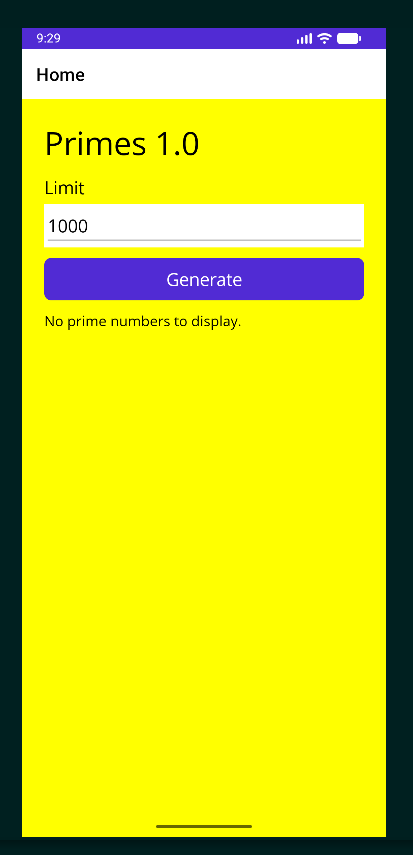

# Primes 1.0

## Description

Primes 1.0 is a C#/.NET MAUI Android application
that generates all prime numbers strictly below a
user-specified positive integer limit.

Developed for the Design of User Interface (CS431)
course at Burgas Free University.

## Technologies

- C#
- .NET 10
- .NET MAUI
- XAML
- Android
- JetBrains Rider

## Features

- Numeric limit input (default: 1000)
- Prime number generation
- Scrollable results
- Input validation
- Previous results replaced on regeneration
- Responsive UI during calculations
- Maximum supported limit: 1,000,000

## Development Environment

- Manjaro Linux
- JetBrains Rider
- .NET 10 SDK
- .NET MAUI Android workload
- Android SDK
- Android emulator

## Windows 11 Requirements

This project targets Android and does not
currently produce a native Windows application.

Required:
- Windows 11
- .NET 10 SDK
- JetBrains Rider with Android support
- Compatible JDK
- Android SDK and emulator or physical device
- MAUI Android workload

## Installation and Build

1. Extract the project ZIP.
2. Open Primes1_0.csproj in JetBrains Rider.
3. Configure Android SDK and JDK paths.
4. Restore NuGet packages.
5. Start an Android emulator.
6. Build and launch the application.

CLI commands from the project directory:

    dotnet workload restore
    dotnet restore
    dotnet build -f net10.0-android

## Usage

1. Launch Primes 1.0.
2. Enter a positive integer in the Limit field.
3. Press Generate.
4. Review the list of prime numbers.
5. Change the limit and regenerate if desired.

## Testing

- Limit 10: 2, 3, 5, 7
- Limit 30: 10 prime numbers, ending with 29
- Limit 100: 25 prime numbers, ending with 97
- Limit 1000: 168 prime numbers, ending with 997
- Limit 2: empty result
- Invalid input: validation error
- Repeated generation: previous results replaced

## Known Limitations

- Android target only.
- An Android emulator or device is required.
- The input limit is restricted to 1,000,000.
- Windows 11 execution has not yet been validated.

